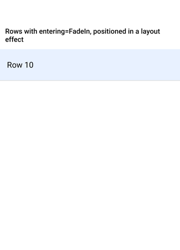
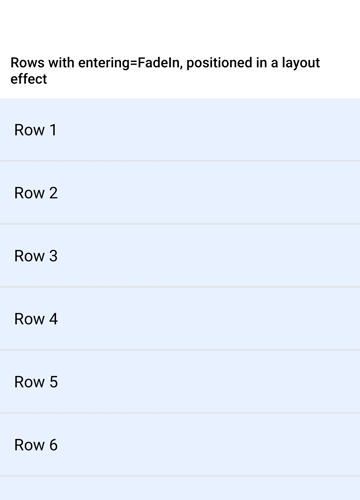
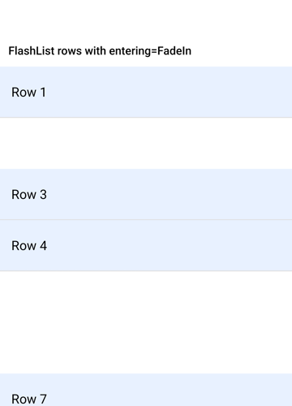

# Reanimated: a view with an `entering` animation keeps its mount-time frame

Minimal reproduction for a `react-native-reanimated` issue on Android (New Architecture).

A view with an `entering` animation is mounted inside a cell. The cell is moved to its
real position in a layout effect, before the first paint, which is what a recycling
list does. The entering view stays where it was mounted.

| `entering={FadeIn}` | same app without `entering` |
| --- | --- |
|  |  |

## Run

```sh
pnpm install   # or npm install
npx expo run:android --variant release
```

`App.tsx` renders ten rows. Expected: ten rows one under another. Actual: all ten are
stacked at the top; only "Row 10" is visible. Removing `entering={FadeIn}` from the row
gives the expected result.

It does not depend on Reduce Motion: the result is the same with animations on and off.

## The same thing in a real list

`App.flashlist.tsx` is the case this came from: `@shopify/flash-list` 2.3.3 rows with
`entering={FadeIn}`. Copy it over `App.tsx` to try it. FlashList mounts items at a
provisional position and then places them, so it hits the same path, but intermittently.
With Reduce Motion on (Android: Settings > Accessibility > Remove animations, or
`adb shell settings put global transition_animation_scale 0`) most rows are missing or
misplaced on most launches:



## Versions

| | |
| --- | --- |
| react-native-reanimated | 4.7.1 (also 4.8.0-nightly-20261004-7cb928218) |
| react-native-worklets | 0.13.0 (also 0.14.0-nightly-20261004-7cb928218) |
| react-native | 0.86.3, New Architecture, Hermes |
| expo | 57.0.26 |
| Device | moto g stylus, Android 11, release build |
